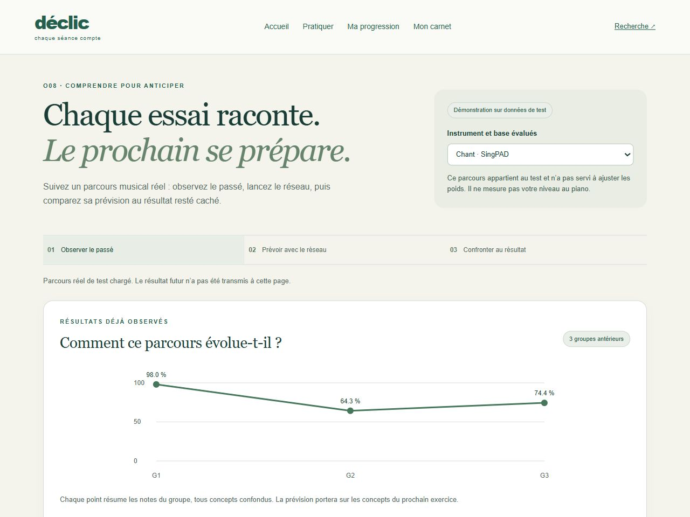
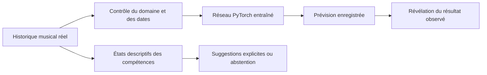

<div align="center">

# DÉCLIC
### Comprendre le passé musical pour prévoir le prochain résultat

**Axe 7 · Objectif O08 · Phase 8 stabilisée**

[](https://github.com/MoallaMelek/Declics-Knowledge-Tracing-for-Learner-Progress-and-Skill-Prediction./actions/workflows/validate.yml)

**36 entraînements neuronaux terminés** · **3 bases musicales** · **350 tests locaux réussis** · **13 scénarios navigateur en CI**

[Lancer la démonstration](docs/START_WINDOWS.md) · [Corrections de l’audit](docs/STABILIZATION_LEDGER.md) · [Préparer la soutenance](docs/PHASE7_PRESENTATION_FR.md) · [Reproduire les expériences](docs/PHASE7_REPRODUCTION.md)

</div>



DÉCLIC aide à lire un parcours d'apprentissage musical : les résultats déjà observés, la prévision d'un réseau entraîné, puis la comparaison avec le résultat réellement obtenu. L'axe 7 reçoit les mesures des autres axes du projet ; l'analyse du son, du rythme ou de la technique reste leur responsabilité.

> **Statut actuel :** démonstration locale et recherche reproductible sur des données musicales réelles. La validation avec un professeur et une nouvelle cohorte reste à réaliser. Aucun bénéfice pédagogique ni transfert automatique au piano n'est démontré.

## Une démonstration en trois gestes

| 1 · Lire le passé | 2 · Calculer la prévision | 3 · Révéler le résultat |
|---|---|---|
| Un vrai parcours de test, séparé des apprenants d'entraînement. | Un modèle PyTorch enregistré utilise uniquement les observations antérieures. | Le résultat observé apparaît après le calcul, avec les erreurs de prévision. |



La page distingue les **observations**, les **prévisions** et les **interprétations descriptives**. Une compétence peu documentée reste indéterminée. Les suggestions utilisent uniquement le catalogue historique disponible et s'abstiennent si aucun exercice adapté n'est connu. Leur efficacité éducative n'a pas été évaluée.

## Phase 8 · Le parcours vivant

[La nouvelle page](http://127.0.0.1:8781/web/living.html) rejoue un vrai parcours de test pas à pas, après le [lancement vérifié](docs/START_WINDOWS.md). À chaque
point de coupure, ses vues utilisent le passé admis ; les résultats ultérieurs sont masqués, même si le rejeu les a déjà affichés. La **constellation** des concepts source s’allume, l’**empreinte
musicale** ajoute un sillon, et l’**observatoire** montre l’entrée réelle du GRU, ses activations enregistrées,
sa prévision et, à la demande, le résultat révélé par le serveur. Les poids ne changent pas pendant le rejeu ;
aucun modèle classique ne produit de prévision. [Rapport Phase 8](docs/PHASE8_LIVING_LEARNER.md).

La stabilisation lie snapshots, caches, inspections et reçus au contenu préparé et aux poids effectivement chargés. `/api/readiness` distingue serveur vivant et démonstration prête ; le lanceur vérifie le bon backend et ne ferme aucun serveur occupant son port. Les erreurs réseau proposent une reprise manuelle, sans boucle automatique. Les quatre vues de Claude sont conservées.

Les prédicteurs restent des [modèles DL expérimentaux](docs/MODEL_ELIGIBILITY_POLICY.md) : Yousician ne bat pas le meilleur contrôle appris publié sur validation. Les [conditions de réutilisation des données](docs/DATA_PROVENANCE_AND_RIGHTS.md) encore non confirmées restent une décision externe.


## Ce qui a réellement été entraîné

| Base | Données longitudinales utilisables | Ce que le modèle cherche à prévoir | Utilisation actuelle |
|---|---|---|---|
| **AMME** | 59 apprenants · 212 groupes | Score continu de similarité mélodique du prochain bloc ; ce n'est pas un pourcentage de notes correctes. | Recherche ; pas de promotion du nouveau modèle. |
| **SingPAD** | 1 042 apprenants · 18 328 groupes | Résultat des concepts du prochain groupe de chant, à partir des annotations de notes. | Démonstration dans le domaine vocal validé. |
| **Yousician** | 999 apprenants · 12 596 jours actifs | Score agrégé du prochain jour actif à l'ukulélé. | Démonstration ukulélé ; aucun transfert universel aux instruments. |

**33 entraînements principaux + 3 extensions Yousician**, sur CPU local. Les trois séparations d'apprenants utilisent les graines 42, 17 et 83. Le protocole compare GRU, variantes d'historique et attention ; chaque base reçoit les conditions pertinentes. Les contrôles statistiques servent à vérifier les résultats scientifiques ; les prévisions de l'application utilisent des réseaux neuronaux.

### Résultats sans sélection sur le test

Moyennes sur les trois séparations ; **plus bas = meilleur**. Le modèle neuronal et le contrôle de chaque séparation sont choisis sur la validation, avant lecture du test.

| Base · mesure | Réseau sélectionné | Contrôle sélectionné | Conclusion descriptive |
|---|---:|---:|---|
| AMME · erreur absolue moyenne | 0,18628 | **0,17245** | Le réseau n'apporte pas de gain moyen. |
| Yousician · erreur absolue moyenne | 0,09089 | **0,09030** | Pas de supériorité moyenne convaincante. |
| SingPAD · perte logarithmique | **0,51792** | 0,52419 | Avantage modeste, encore exploratoire. |

L'extension Yousician enrichie par le contexte historique n'améliore pas clairement la moyenne. Le recalibrage des probabilités n'aide pas systématiquement. Les séparations réutilisent la cohorte Phase 6 : elles ne remplacent pas une confirmation sur une nouvelle cohorte.


[Tableaux complets et limites](docs/PHASE7_RESULTS.md) · [Résumé vérifiable en JSON](artifacts/phase7/summary.json) · [Provenance des exécutions](artifacts/phase7/execution-provenance.json)

## Lancer l'application

**Pour la Phase 8 (`living.html`), utiliser `Launch.ps1`** depuis la racine du dépôt après préparation de l’environnement ci-dessous :

```powershell
.\Launch.ps1
```

Ouvrir l’URL affichée par le lanceur (port 8781 par défaut). Il vérifie `/api/readiness` et refuse un port occupé ; `-Port 8782` permet de choisir un autre port. Les commandes Uvicorn ci-dessous concernent le parcours O08 sur 8773 et ne démarrent pas le lanceur Phase 8. Voir le [guide Windows](docs/START_WINDOWS.md) pour les données privées requises et les diagnostics.

Python **3.12 ou supérieur**, depuis la racine du dépôt :

```powershell
python -m venv .venv
.\.venv\Scripts\python.exe -m pip install -e '.[test]' --extra-index-url https://download.pytorch.org/whl/cpu
.\.venv\Scripts\python.exe -m uvicorn axis7.server:app --host 127.0.0.1 --port 8773
```

Ouvrir **[la démonstration O08](http://127.0.0.1:8773/web/o08.html)**, ou [le carnet musical](http://127.0.0.1:8773/). Sur la machine de livraison, le serveur et les exemples réels sont déjà préparés.

**Sur une nouvelle installation**, les poids et rapports publics sont inclus, mais les archives sources et les parcours individuels de démonstration restent privés. Après acquisition autorisée des archives, reconstruire les deux exemples :

```powershell
.\.venv\Scripts\python.exe scripts/build_musical_demo.py --source singpad --archive 'CHEMIN/singKT-dataset-main.zip'
.\.venv\Scripts\python.exe scripts/build_musical_demo.py --source yousician --archive 'CHEMIN/yousician_ukulele.json.zip'
```

Sans ces fichiers, la démonstration signale leur absence. Les droits de réutilisation et conditions propres à chaque source continuent de s'appliquer ; la présence de ce code ne donne aucun droit supplémentaire sur les données. Voir le [guide de reproduction](docs/PHASE7_REPRODUCTION.md) et les [décisions sur les données musicales](docs/MUSIC_DATA_PHASE4.md).

Les modèles actifs antérieurs validés sont conservés. Les 36 poids Phase 7 sont des artefacts de recherche et ne remplacent pas automatiquement le registre actif. Le carnet piano conserve l'abstention lorsque le domaine et la mesure ne sont pas validés.

## Ce qui est prêt, ce qui reste à prouver

| Livré et vérifié | Prochaine validation nécessaire |
|---|---|
| Prévisions réelles, révélation différée et affichage mobile | Revue d'usage avec un professeur et des élèves |
| États descriptifs et règles de suggestions testés | Taxonomie, seuils et contenu des exercices approuvés par un enseignant |
| Collecte locale volontaire, dates de disponibilité, export et suppression | Contrat de mesure commun aux axes et véritable pilote consenti |
| Contrôles appris, calibration, données manquantes et CV AMME avec Ridge | Nouvelle cohorte, incertitude individuelle et confirmation indépendante |
| API bornée, tests de causalité et poids vérifiés | Authentification par utilisateur et audit avant mise en ligne |

La collecte prospective est désactivée sans jeton administrateur local. Même activée, ses prévisions terrain restent en **abstention** tant qu'aucun contrat de mesure et modèle de domaine n'est validé. Le jeton local ne constitue pas une authentification d'élève ni une solution de déploiement public.

## Guides pour l'équipe et la soutenance

| Besoin | Document |
|---|---|
| Comprendre les choix et les limites | [Rapport scientifique et technique](docs/PHASE7_REPORT.md) |
| Examiner toutes les mesures | [Résultats détaillés](docs/PHASE7_RESULTS.md) |
| Refaire l'étude et reprendre une interruption | [Reproduction et exploitation](docs/PHASE7_REPRODUCTION.md) |
| Présenter l'application en classe | [Parcours de démonstration](docs/PHASE7_DEMO_GUIDE.md) |
| Expliquer le projet en cinq minutes | [Oral en français](docs/PHASE7_PRESENTATION_FR.md) |
| Préparer les questions du professeur | [Questions et réponses](docs/PHASE7_QA_FR.md) |
| Partager une synthèse en anglais | [Executive summary](docs/PHASE7_EXECUTIVE_SUMMARY_EN.md) |
| Vérifier la livraison | [Preuves et vérifications](docs/PHASE7_VERIFICATION.md) |
| Retrouver l'entraînement Colab | [Guide Phase 5](docs/PHASE5_COLAB.md) |
| Consulter les anciennes phases | [Archive du README Phases 1 à 5](docs/README_HISTORY_PHASE1_5.md) |

## Vérifier le code

```powershell
.\.venv\Scripts\python.exe -m pytest -q
node --check web/o08.js
node --check web/musician.js
```

**350 tests locaux réussis** · **13 scénarios navigateur en CI** dans la CI de la livraison du code Phase 7 : [exécution vérifiée](https://github.com/MoallaMelek/Declics-Knowledge-Tracing-for-Learner-Progress-and-Skill-Prediction./actions/runs/38801586386), commit `05f2757bc8f6c803fe6886559109923277b9a90d`. Le badge en haut suit la branche et les changements documentaires suivants. Les tests couvrent notamment la causalité temporelle, les partitions d'apprenants, les contrats, la révélation du résultat, la rétention et les reprises d'analyse.

<details>
<summary>Compatibilité et historique des objectifs</summary>

La Phase 7 désigne la fonction de prévision par **O08**, conformément à son cahier des charges. Les contrats historiques v3 gardent la correspondance de la version d'objectifs 1-1 disponible à l'époque, où l'axe 7 était O09. Cette compatibilité est conservée et ne crée aucune correspondance de compétences approuvée. Les anciennes études FORGET-SE et les simulations musicales restent archivées dans leurs domaines respectifs.

</details>
