<div align="center">

# DÉCLIC
### Entraîner son oreille sans instrument, et vérifier ce que le modèle prévoit

**Axe 7 · Objectif O08 — compétences de l’apprenant et performance future**

[](https://github.com/MoallaMelek/Declics-Knowledge-Tracing-for-Learner-Progress-and-Skill-Prediction./actions/workflows/validate.yml)

**12 exercices sans instrument · 53 niveaux** · **36 entraînements neuronaux** · **3 bases musicales réelles** · **507 tests Python** · **28 scénarios navigateur en CI**

[Apprendre sans instrument](#apprendre-sans-instrument-phase-10) · [Lancer](#lancer-en-deux-minutes) · [Visite guidée](#visite-guidée) · [Ce que montre l’interface](#quatre-types-dinformation-jamais-mélangés) · [Résultats](#ce-qui-a-réellement-été-entraîné) · [Avant / après](#avant--après-la-refonte-phase-9) · [Guides](#guides-pour-léquipe-et-la-soutenance)

</div>

<p align="center">
  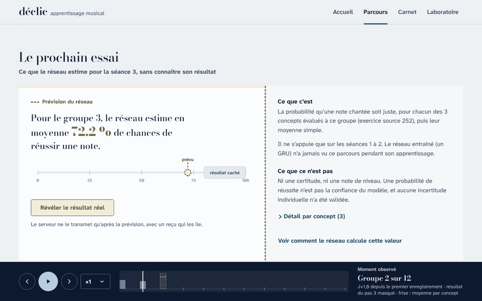
  <br><sub>Capture réelle de l’application : la frise avance d’une séance à la fois, la prévision n’utilise que le passé, puis le résultat réel est révélé et l’écart reste visible. <em>(Montage d’intégration synthétique avec les vrais poids entraînés.)</em></sub>
</p>

## Apprendre sans instrument (Phase 10)

Ouvrez DÉCLIC, créez votre profil, cliquez **Commencer une séance** :
- les sons sont joués par le navigateur ;
- vous répondez à la souris, au clavier de l’ordinateur ou à la barre d’espace ;
- le serveur corrige chaque réponse ;
- **Parcours** suit vos niveaux, jour après jour.

Avant chaque question, une prévision O08 de votre réussite est enregistrée, puis comparée au résultat réel.

<p align="center">
  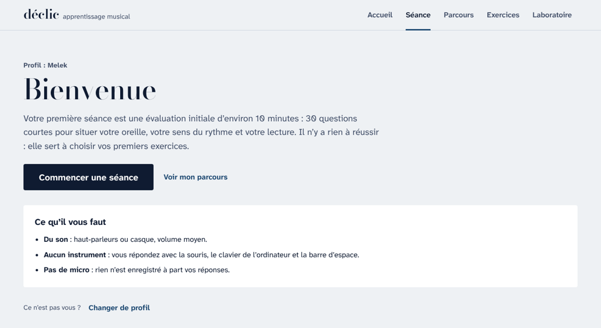
  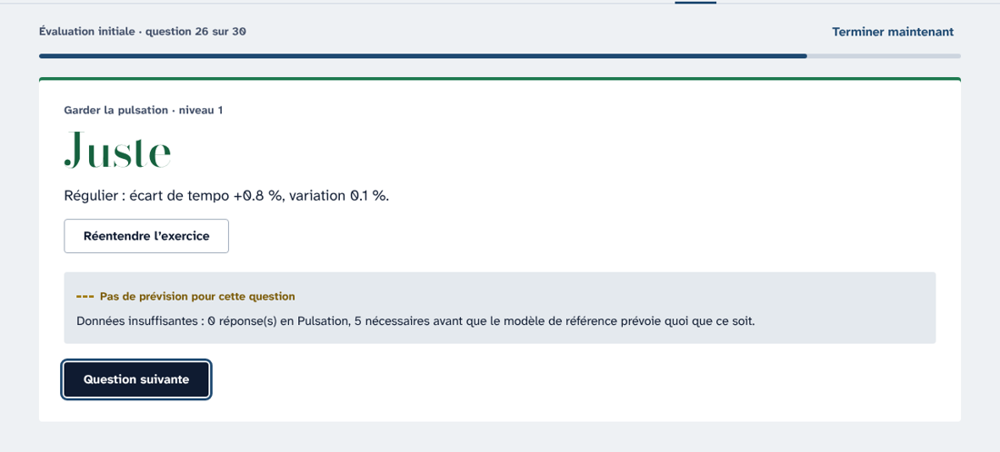
</p>
<p align="center">
  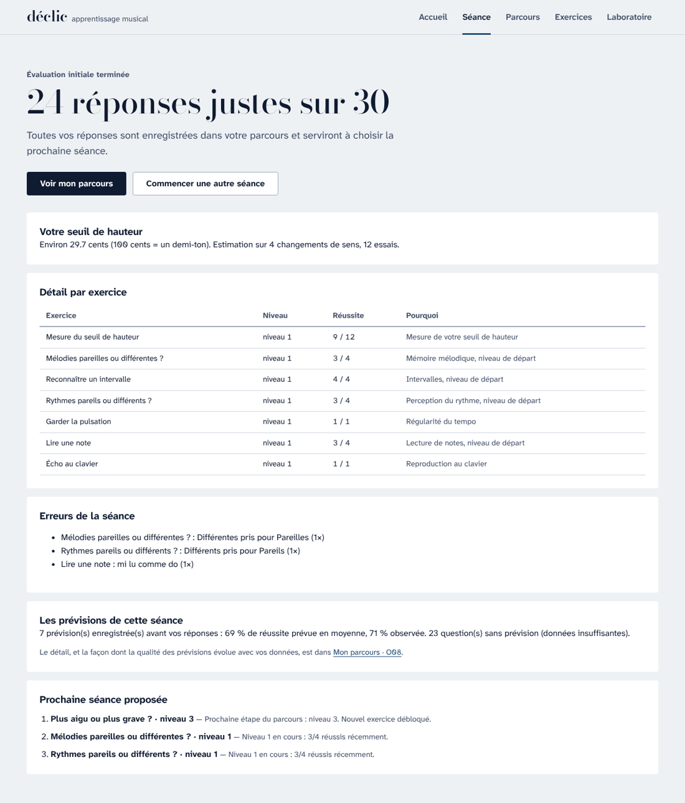
  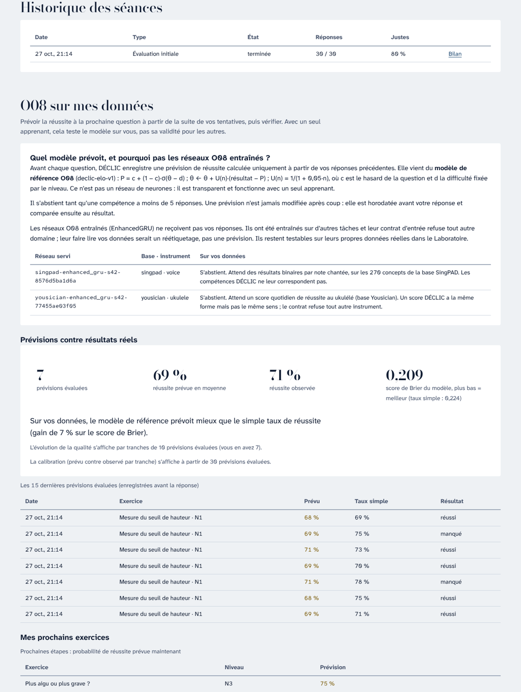
</p>

| Page | Pour |
|---|---|
| **Séance** | Évaluation initiale (30 questions), puis séances d’environ 10 minutes composées à partir de vos résultats ; reprise si vous quittez en cours |
| **Parcours** | Carte de maîtrise des 53 niveaux, forces et points à travailler, erreurs récurrentes, historique, **O08 sur mes données** |
| **Exercices** | 12 fiches en 10 champs : objectif, compétence, niveaux à difficulté vérifiable, prérequis, consignes, entrées, résultat, correction, métriques, références |
| **Laboratoire** | Rejeu O08 des réseaux entraînés sur données réelles, bancs d’essai, limites |

**Ce qu’il faut savoir :**
- Les réseaux O08 entraînés (SingPAD, Yousician) **ne reçoivent pas** vos réponses : leur contrat d’entrée ne les accepte pas, et c’est voulu.
- Vos prévisions viennent d’un modèle de référence transparent, présenté comme tel, qui s’abstient tant que les données sont insuffisantes.
- Rapports :
  - [boucle de l’apprenant et blocages](docs/PHASE10_LEARNER_LOOP.md) ;
  - [audit des modèles, matrice des entrées, YouTube](docs/PHASE10_MODEL_AUDIT.md) ;
  - [recherche pédagogique et fiches](docs/PHASE10_PEDAGOGY.md) ;
  - [guide sans instrument](docs/GUIDE_SANS_INSTRUMENT.md).

## La recherche O08

DÉCLIC aide à lire un parcours d’apprentissage musical : ce qui a été **observé**, ce qu’on peut en **lire**, ce que **prévoit** un réseau de neurones entraîné pour l’essai suivant, puis le résultat **révélé** après coup. L’axe 7 reçoit les mesures des autres axes du projet ; l’analyse du son, du rythme ou de la technique reste leur responsabilité.

> **Statut :** démonstration locale et recherche reproductible sur des données musicales réelles. La validation avec un enseignant et une nouvelle cohorte reste à faire. Aucun bénéfice pédagogique ni transfert au piano n’est démontré.

## Lancer en deux minutes

Depuis la racine du dépôt, une fois l’environnement préparé ([guide Windows](docs/START_WINDOWS.md)) :

```powershell
.\Launch.ps1 -Open
```

Ou double-cliquer **`Lancer DECLIC.cmd`** à la racine du dépôt : le lanceur démarre, vérifie que la démonstration est prête et ouvre l’accueil dans le navigateur.

| Ouvrir | Pour |
|---|---|
| `http://127.0.0.1:8781/` | **Accueil** — commencer ou reprendre |
| `http://127.0.0.1:8781/web/seance.html` | **Séance** — exercices sans instrument, corrigés |
| `http://127.0.0.1:8781/web/parcours.html` | **Parcours** — votre progression et O08 sur vos données |
| `http://127.0.0.1:8781/web/exercices.html` | **Exercices** — la bibliothèque et ses références |
| `http://127.0.0.1:8781/web/labo.html` | **Laboratoire** — Rejeu O08 sur données réelles, bancs d’essai, limites |
| `http://127.0.0.1:8781/web/living.html` | **Rejeu O08** — un parcours de recherche rejoué séance après séance |
| `http://127.0.0.1:8781/web/carnet.html` | **Carnet piano** — auto-évaluation, nécessite un piano |

Le lanceur vérifie `/api/readiness`, refuse un port occupé (`-Port 8782` pour en choisir un autre) et ne ferme jamais un autre serveur.

<details>
<summary><strong>Première installation, données privées et autres modes de lancement</strong></summary>

Python **3.12 ou supérieur** :

```powershell
python -m venv .venv
.\.venv\Scripts\python.exe -m pip install -e '.[test]' --extra-index-url https://download.pytorch.org/whl/cpu
```

Les poids et rapports publics sont inclus ; les archives sources et les parcours individuels restent privés. Après acquisition autorisée des archives, reconstruire les deux démonstrations :

```powershell
.\.venv\Scripts\python.exe scripts/build_musical_demo.py --source singpad --archive 'CHEMIN/singKT-dataset-main.zip'
.\.venv\Scripts\python.exe scripts/build_musical_demo.py --source yousician --archive 'CHEMIN/yousician_ukulele.json.zip'
```

Sans ces fichiers, chaque page signale leur absence et propose un diagnostic ; aucune valeur n’est inventée. Les droits propres à chaque source continuent de s’appliquer ([provenance et droits](docs/DATA_PROVENANCE_AND_RIGHTS.md), [décisions sur les données](docs/MUSIC_DATA_PHASE4.md)).

Serveur seul, sans le lanceur (port 8773) :

```powershell
.\.venv\Scripts\python.exe -m uvicorn axis7.server:app --host 127.0.0.1 --port 8773
```

</details>

## Visite guidée

Depuis la Phase 10, la navigation est **Accueil · Séance · Parcours · Exercices · Laboratoire** ; la page ci-dessous appelée « Parcours » en Phase 9 s’appelle désormais **Rejeu O08** et se trouve dans le Laboratoire. Captures de la Phase 9 :

<details open>
<summary><strong>Accueil</strong> — ce que fait DÉCLIC, en une phrase, et trois portes selon le besoin</summary>
<br>

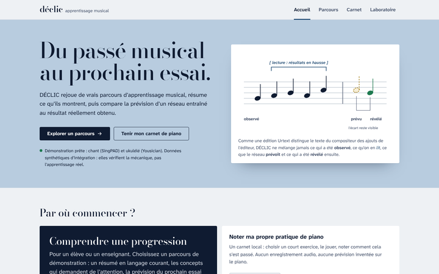

- Une action principale : **Explorer un parcours**. Les deux autres portes : le carnet de piano et le laboratoire.
- La portée illustre la règle du produit : notes pleines = observé, crochets = lecture, note en pointillé = prévision, note verte = révélé.
- La seule information « vivante » est vraie : l’état de la démonstration, lu sur `/api/readiness`.
- Les limites sont réunies en bas de page, sans petits caractères.

</details>

<details>
<summary><strong>Rejeu O08</strong> (« Parcours » en Phase 9) — lire un vrai parcours de recherche, séance après séance</summary>
<br>

**1. En bref.** Un résumé en langage courant de ce qui a été observé jusqu’au moment choisi, les concepts qui demandent de l’attention ou qui sont réguliers, et une piste de pratique — ou une abstention explicite.

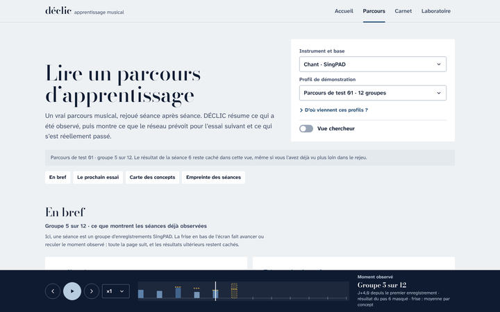

**2. Le prochain essai.** La prévision en une phrase, avec sa cible et son unité, « ce que c’est » et « ce que ce n’est pas ». Le résultat réel reste caché jusqu’au clic sur *Révéler le résultat réel* ; le serveur ne le transmet qu’avec le reçu de la prévision.

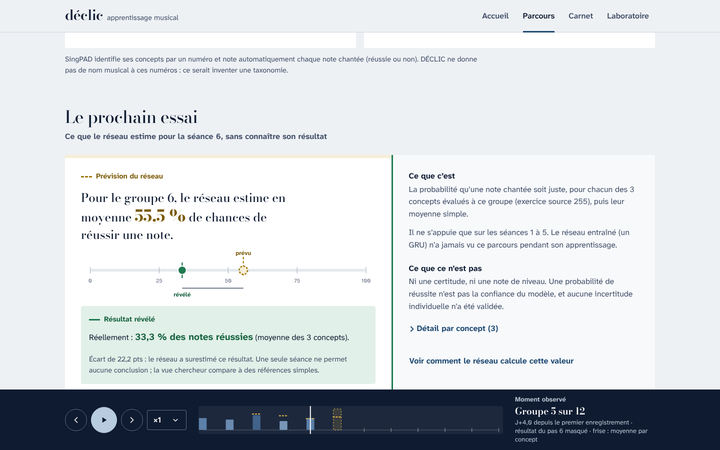

**3. Remonter le temps.** La frise en bas de l’écran change le moment observé ; toutes les vues suivent, et les résultats ultérieurs restent cachés même s’ils ont déjà été vus plus loin.

**4. Carte des concepts et empreinte des séances.** Des vues d’exploration, expliquées : chaque point est un concept réellement évalué, sa couleur décrit ses résultats, sa taille le nombre de notes ; un vide dans l’empreinte veut dire « non mesuré », jamais « échec ». Tout est aussi lisible en tableau.

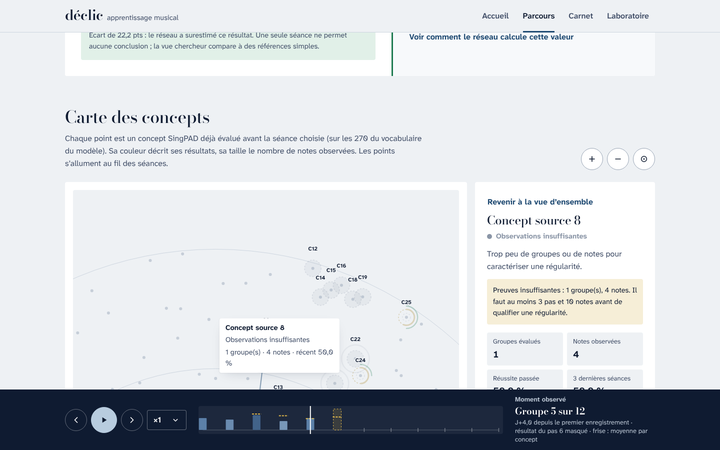

**5. Vue chercheur (interrupteur).** Ajoute le calcul réel : historique, tenseurs, mémoire GRU enregistrée, logits, prévision servie avec sa provenance et son **reçu signé**, puis l’évaluation face à des références simples.

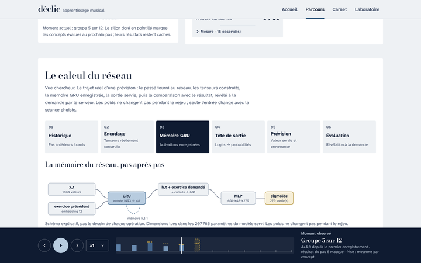

Deux bases : **Chant · SingPAD** (probabilité de réussir une note, par concept) et **Ukulélé · Yousician** (score continu sur 100 du prochain jour actif, jamais présenté comme une probabilité).

</details>

<details>
<summary><strong>Carnet</strong> — pour un élève pianiste : noter sa propre pratique, sans prévision inventée</summary>
<br>

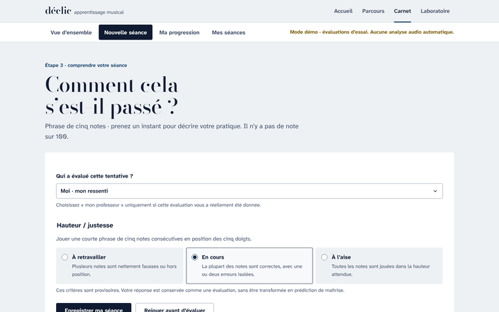

Choisir un court exercice, le jouer, noter comment cela s’est passé (soi-même ou d’après son professeur), retrouver ses séances. Les évaluations restent sur l’appareil ; aucun son ni vidéo n’est enregistré. Le carnet ne prévoit rien au piano : aucun modèle n’y est validé.

</details>

<details>
<summary><strong>Laboratoire</strong> — pour un professeur ou un jury : le modèle, ses preuves et ses limites</summary>
<br>

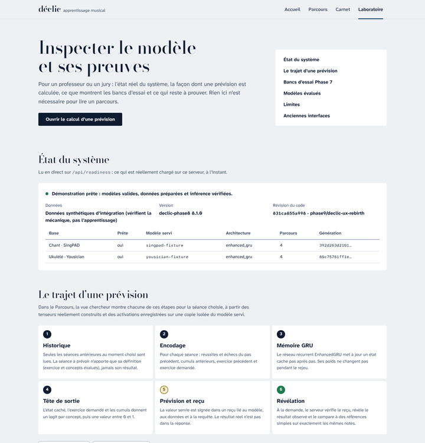

- **État du système** en direct : modèle servi, architecture, génération des données, révision du code.
- **Le trajet d’une prévision** en six étapes, avec un lien direct vers le calcul réel d’un parcours.
- **Bancs d’essai Phase 7**, **modèles servis** et **limites publiées**, lus sur l’API, sans chiffre recopié à la main.
- **Anciennes interfaces** (phases 1 à 7), archivées et signalées ; la simulation des phases 1 à 5 est étiquetée comme telle.

</details>

<details>
<summary><strong>Sur téléphone</strong></summary>
<br>

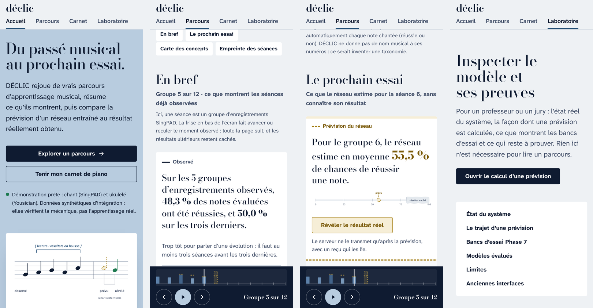

</details>

## Quatre types d’information, jamais mélangés

Comme une édition *Urtext* distingue le texte du compositeur des ajouts de l’éditeur, chaque bloc porte la marque de sa catégorie.

| | Catégorie | Ce que c’est | Marque visuelle |
|---|---|---|---|
| ▬ | **Observé** | ce qui a réellement été enregistré | encre pleine |
| ⟦ | **Lecture** | ce que les observations permettent de décrire | crochets, italique bleu |
| ┄ | **Prévision** | ce qu’estime le réseau entraîné, sans connaître le résultat | pointillé ocre |
| ● | **Révélé** | le résultat réel, montré après la prévision | vert plein, écart visible |

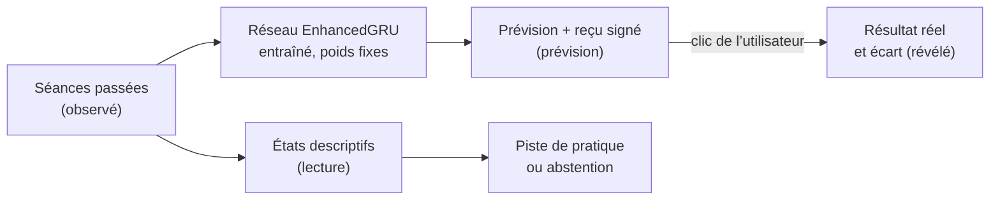

Une compétence peu documentée reste « observations insuffisantes ». Les pistes de pratique n’utilisent que le catalogue déjà observé et s’abstiennent sinon. Les concepts SingPAD n’ont que des numéros dans les données : DÉCLIC ne leur invente pas de nom musical.

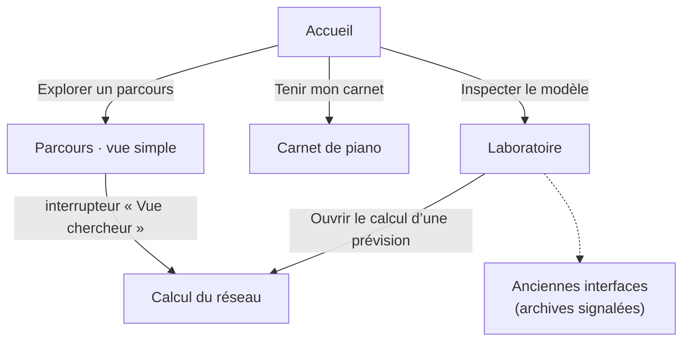

## Ce qui a réellement été entraîné

| Base | Données longitudinales utilisables | Ce que le modèle cherche à prévoir | Utilisation actuelle |
|---|---|---|---|
| **AMME** | 59 apprenants · 212 groupes | Score continu de similarité mélodique du prochain bloc ; ce n’est pas un pourcentage de notes correctes. | Recherche ; pas de promotion du nouveau modèle. |
| **SingPAD** | 1 042 apprenants · 18 328 groupes | Résultat des concepts du prochain groupe de chant, à partir des annotations de notes. | Démonstration dans le domaine vocal. |
| **Yousician** | 999 apprenants · 12 596 jours actifs | Score agrégé du prochain jour actif à l’ukulélé. | Démonstration ukulélé ; aucun transfert aux autres instruments. |

**33 entraînements principaux + 3 extensions Yousician**, sur CPU local, trois séparations d’apprenants (graines 42, 17 et 83). Le protocole compare GRU, variantes d’historique et attention. Les contrôles statistiques servent à vérifier la science ; les prévisions de l’application viennent uniquement des réseaux neuronaux.

### Résultats sans sélection sur le test

Moyennes sur les trois séparations ; **plus bas = meilleur**. Réseau et contrôle de chaque séparation sont choisis sur la validation, avant lecture du test.

| Base · mesure | Réseau sélectionné | Contrôle sélectionné | Conclusion descriptive |
|---|---:|---:|---|
| AMME · erreur absolue moyenne | 0,18628 | **0,17245** | Le réseau n’apporte pas de gain moyen. |
| Yousician · erreur absolue moyenne | 0,09089 | **0,09030** | Pas de supériorité moyenne convaincante. |
| SingPAD · perte logarithmique | **0,51792** | 0,52419 | Avantage modeste, encore exploratoire. |

L’extension Yousician enrichie par le contexte n’améliore pas clairement la moyenne ; le recalibrage n’aide pas systématiquement ; les séparations réutilisent la cohorte Phase 6 et ne remplacent pas une nouvelle cohorte. Les prédicteurs restent des [modèles expérimentaux](docs/MODEL_ELIGIBILITY_POLICY.md).

<details>
<summary>Figure : comparaison des représentations sur SingPAD</summary>
<br>

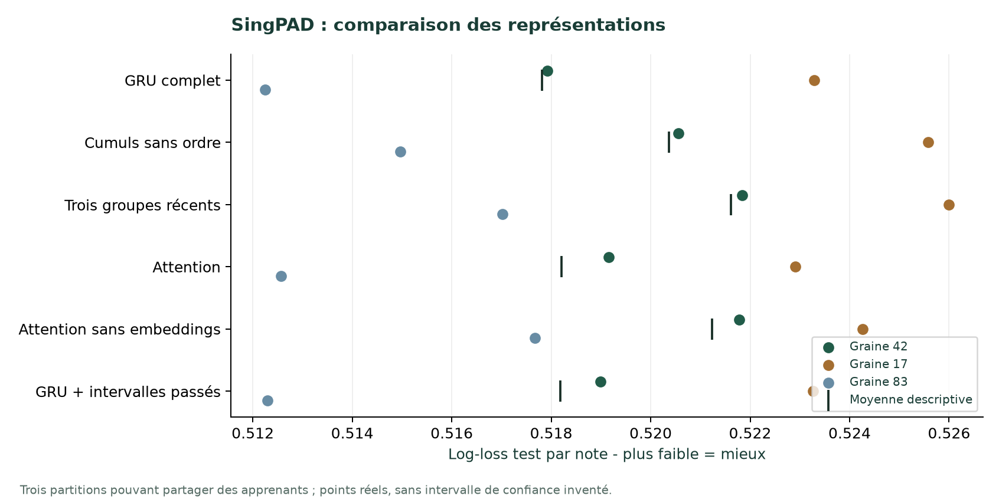

</details>

[Tableaux complets et limites](docs/PHASE7_RESULTS.md) · [Résumé vérifiable en JSON](artifacts/phase7/summary.json) · [Provenance des exécutions](artifacts/phase7/execution-provenance.json)

**Notebook exécuté des modèles servis :** [`notebooks/DECLIC_resultats.ipynb`](notebooks/DECLIC_resultats.ipynb) relit les exports des entraînements Colab (checkpoint vérifié par le registre, architecture, courbes de validation, test contre contrôles, bootstrap, calibration, comparaison DKT / GRU / attention, sous-groupes). Ses sorties sont enregistrées ; il ne réentraîne rien. Les notebooks `DECLIC_<base>.ipynb` restent des modèles vides à lancer sur Colab, car leurs sorties brutes sont privées. Régénérer : `python scripts/build_results_notebook.py`.

## Avant / après la refonte (Phase 9)

L’interface comptait sept pages, cinq navigations et quatre identités visuelles ; même ses développeurs s’y perdaient. Elle est devenue une seule application. Le moteur scientifique de la Phase 8 (gardes de causalité, identité des générations, reçus HMAC, cache limité aux séances visitées) est conservé tel quel et reste couvert par ses tests.

<details>
<summary><strong>Voir les comparaisons</strong></summary>
<br>

**Entrée.** Avant : `/` ouvrait le carnet piano, sans lien visible vers O08. Après : une page qui explique et oriente.

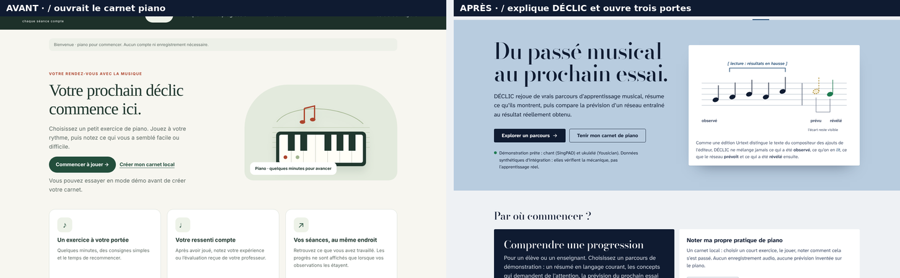

**Parcours.** Avant : la science d’abord. Après : la lecture simple d’abord, la science en vue chercheur.

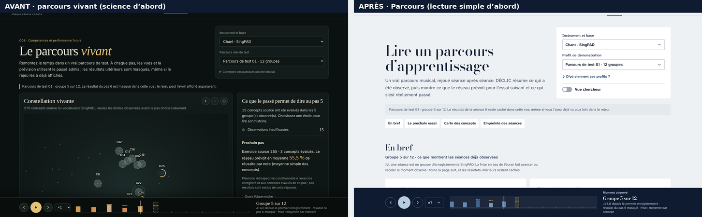

**Recherche.** Avant : une simulation titrée « Votre progression ». Après : un Laboratoire alimenté par l’API, la simulation archivée et signalée.

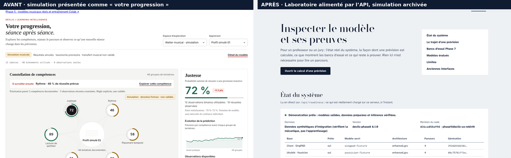

</details>

[Audit complet, système de design, vérifications et limites de la refonte](docs/PHASE9_UX_REBIRTH.md)

## Ce qui est prêt, ce qui reste à prouver

| Livré et vérifié | Prochaine validation nécessaire |
|---|---|
| Prévisions réelles, révélation différée, interface unique, affichage mobile | Revue d’usage avec un enseignant et des élèves |
| États descriptifs et règles de suggestions testés | Taxonomie, seuils et exercices approuvés par un enseignant |
| Collecte locale volontaire, dates de disponibilité, export et suppression | Contrat de mesure commun aux axes et pilote consenti |
| Contrôles appris, calibration, données manquantes et CV AMME avec Ridge | Nouvelle cohorte, incertitude individuelle, confirmation indépendante |
| API bornée, tests de causalité, poids et reçus vérifiés | Authentification par utilisateur et audit avant mise en ligne |

La collecte prospective est désactivée sans jeton administrateur local ; même activée, ses prévisions terrain restent en **abstention** tant qu’aucun contrat de mesure n’est validé.

## Vérifier le code

```powershell
.\.venv\Scripts\python.exe -m pytest -q
$env:DECLIC_PYTHON = (Resolve-Path .venv\Scripts\python.exe).Path
npm ci; npx playwright install chromium; npm run test:browser
```

La CI exécute les 427 tests Python, les harnais Node du moteur (causalité, synchronisation des vues, absence de fuite du futur, carnet) et **16 scénarios Chromium réels** sur le montage d’intégration synthétique avec les vrais poids entraînés : navigation entre les quatre destinations, première visite et révélation au clavier, comparaison épinglée, rejeu, reprises après coupure réseau ou arrêt du serveur, réponses obsolètes, reçus expirés, clavier et mobile. Pour rejouer ces scénarios sur les données privées réelles de la machine de livraison : `$env:DECLIC_E2E_REAL='1'` et `$env:DECLIC_PREPARED_DATA` vers le dossier préparé.

## Guides pour l’équipe et la soutenance

| Besoin | Document |
|---|---|
| Comprendre la nouvelle interface | [Refonte Phase 9](docs/PHASE9_UX_REBIRTH.md) |
| Comprendre le rejeu et ses quatre vues | [Parcours vivant Phase 8](docs/PHASE8_LIVING_LEARNER.md) |
| Lancer sur Windows et diagnostiquer | [Guide Windows](docs/START_WINDOWS.md) |
| Comprendre les choix et les limites | [Rapport scientifique et technique](docs/PHASE7_REPORT.md) |
| Examiner toutes les mesures | [Résultats détaillés](docs/PHASE7_RESULTS.md) |
| Refaire l’étude | [Reproduction et exploitation](docs/PHASE7_REPRODUCTION.md) |
| Présenter en classe | [Parcours de démonstration](docs/PHASE7_DEMO_GUIDE.md) · [Oral en français](docs/PHASE7_PRESENTATION_FR.md) |
| Préparer les questions du professeur | [Questions et réponses](docs/PHASE7_QA_FR.md) |
| Partager une synthèse en anglais | [Executive summary](docs/PHASE7_EXECUTIVE_SUMMARY_EN.md) |
| Vérifier la livraison | [Preuves et vérifications](docs/PHASE7_VERIFICATION.md) · [Corrections de l’audit](docs/STABILIZATION_LEDGER.md) |
| Retrouver l’entraînement Colab | [Guide Phase 5](docs/PHASE5_COLAB.md) |

<details>
<summary>Historique : Phase 8 et anciennes phases</summary>

La Phase 8 a introduit le rejeu causal d’un parcours de test, la constellation des concepts, l’empreinte musicale et l’observatoire du GRU ; sa stabilisation lie snapshots, caches, inspections et reçus au contenu préparé et aux poids effectivement chargés. Ces quatre expériences sont toutes conservées dans le Parcours de la Phase 9. [Rapport Phase 8](docs/PHASE8_LIVING_LEARNER.md) · [Rapport de stabilisation](docs/PHASE8_STABILIZATION_REPORT.md).

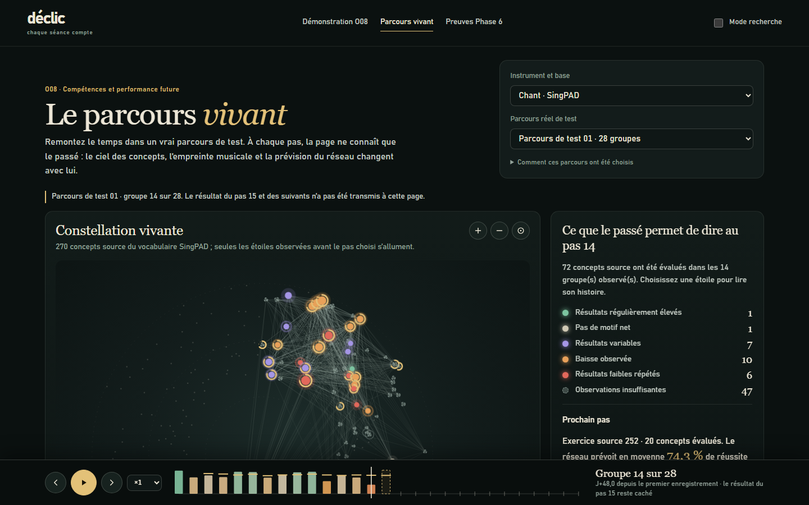

La Phase 7 désigne la fonction de prévision par **O08**, conformément à son cahier des charges ; les contrats historiques v3 gardent la correspondance de l’époque où l’axe 7 était O09, sans créer de correspondance de compétences approuvée. Les anciennes études FORGET-SE et les simulations musicales restent archivées. [Archive du README des phases 1 à 5](docs/README_HISTORY_PHASE1_5.md).

</details>
