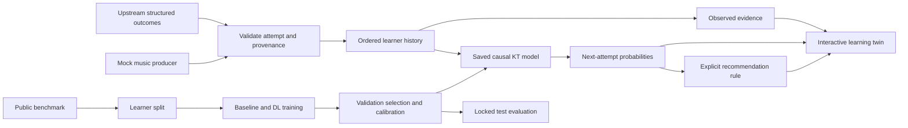

# Axis 7 specification before implementation

Date: 2026-10-06. Source authority: all 15 supplied documents inspected before application code. See the research report and source manifest for evidence. This specification is an engineering decision, not a partner-approved rubric.

## Boundary

Axis 7 consumes structured outcomes from axes 1 (notes), 2 (timing), 3 (alignment), 4 (teacher rubric), 5 (visible technique), 6 (instrument context). It does not infer these outcomes from media. The older six computer-vision modules and Investigate O1–O9 are different enumerations. Partner: Espace Khazna d'Art; instrument, taxonomy, tolerances and consent remain unresolved. The user's request authorizes an independent KT research prototype despite Investigate's deferral of learned local personalization.

## Scientific task

Predict P(y_t=1 | ordered observations strictly before attempt t, skill requested at t). Never feed current or future correctness into the prediction. Each attempt is atomic: multiple skill observations are averaged into one input vector and simultaneously predicted; no one skill's current outcome informs another. Pooled binary labels and continuous scores are different tasks. Fit no preprocessing statistic on validation/test outcomes. Split by learner before generating windows. Evaluate complete held-out histories causally and separately report early/late positions.

Compare training-only smoothed skill priors, Bayesian Knowledge Tracing (BKT), logistic performance-factor analysis (PFA), DKT-style GRU and bounded SAKT. Hidden state is latent representation, not identified psychological mastery. DKT/SAKT per-skill outputs are reference next-attempt probabilities, explicitly labeled a readiness proxy. BKT mastery is conditional on its assumptions. Recommendation ranks fragile observed skills by predicted success and evidence coverage, with an explicit heuristic policy; it does not estimate causal learning gains. No prerequisite graph will be invented.

## Data routes

1. Music datasets SingPAD/SingKT and OcarinaKT: audit primary release, chronology, licenses before acquisition/reuse. Public availability is not a reuse license.
2. Legally explicit general KT benchmark if music rights/order cannot be established. Never rename general subject concepts as musical labels.
3. Deterministic synthetic music fixtures and mock producers for independent integration/demo. Provisional pitch/rhythm/timing/articulation/fingering/score-navigation taxonomy from project concerns; not a teacher-validated assessment. Synthetic training/evaluation is only a controlled pipeline check, not evidence of performance on real musicians.

## Canonical schema v1

Attempt ID, pseudonymous learner, session, exercise, instrument, timezone-aware timestamp, provenance, rubric version, skill observations with skill ID and binary outcome or declared continuous score. Optional pitch/rhythm/gesture/error signals retain missingness and source confidence. Duplicate IDs, unknown skills, invalid values or out-of-order ingestion fail with clear errors. Attempts with missing binary targets are retained for evidence but excluded from binary loss. No external aggregate score enters the learner state.

## Modules and artifacts

`axis7/schema.py`: validation; `data.py`: acquisition/adapters/splits/fixtures; `models.py`: baseline and causal neural models; `train.py`: seed/config/checkpoint/evaluation; `metrics.py`: AUC, PR-AUC, Brier/log loss, calibration and grouped analysis; `inference.py`: reusable saved-model predictions/evidence/recommendation; `server.py`: local API and persisted demo event stream; `web/`: interactive skill constellation, evidence detail, session playback and ingestion. Research notes separate from application modules.

Models selected by validation log loss, temperature tuned on validation only. Test evaluated after selection. Save IDs, hashes, config, dependency versions, learning curves, calibration/error/per-skill analysis, learner-bootstrap intervals and seed results. A stronger architecture can lose; report that result. UI is built only after baseline and neural experiment results exist.

## Outstanding validation

Real local musical generalization, psychological mastery, recommendations' educational efficacy, continuous musical targets, forgetting/time-gap effects, authentic exercise difficulty and teacher taxonomy are not established by this prototype. Time fields are retained but not used unless trustworthy benchmark chronology supports them. No universal confidence intervals for individual mastery will be fabricated.
