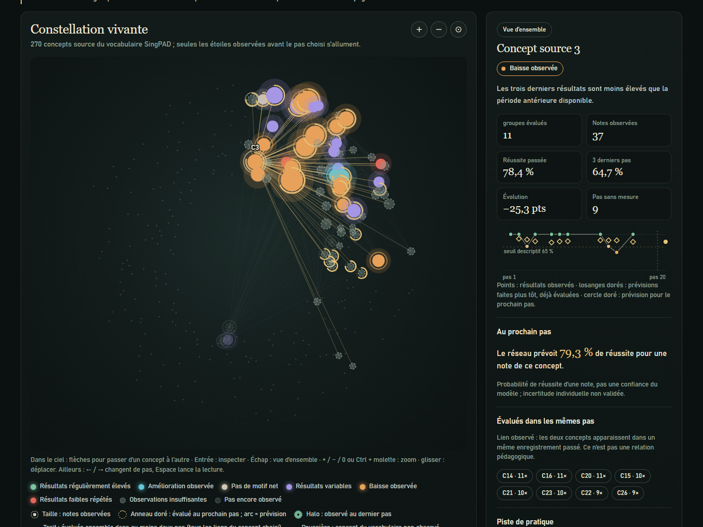
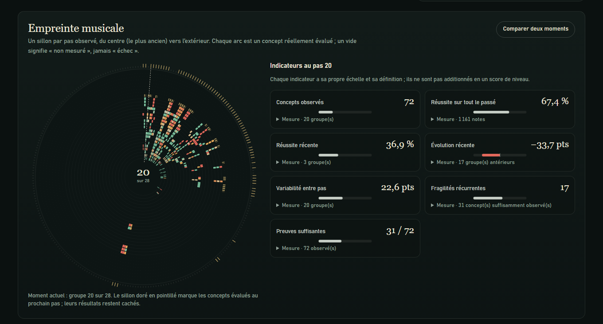
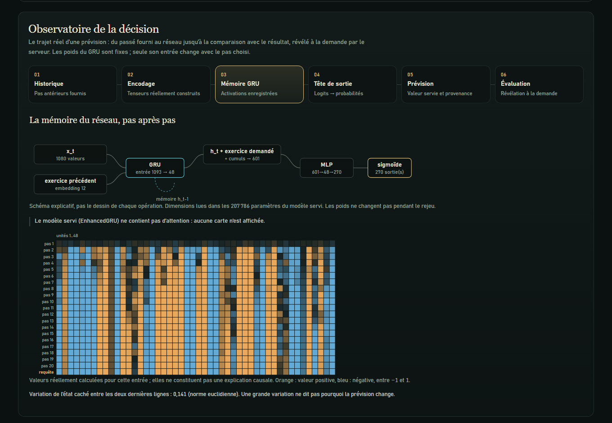
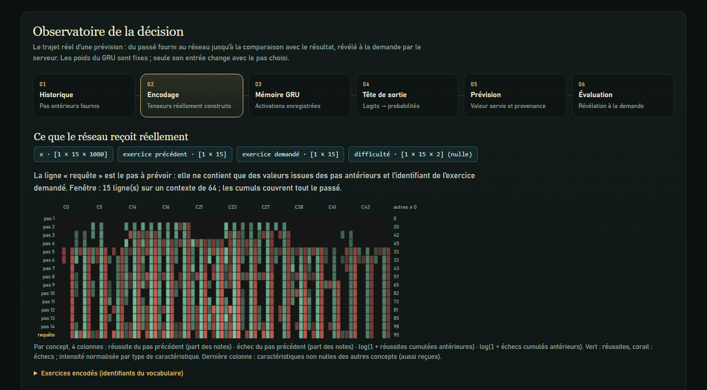
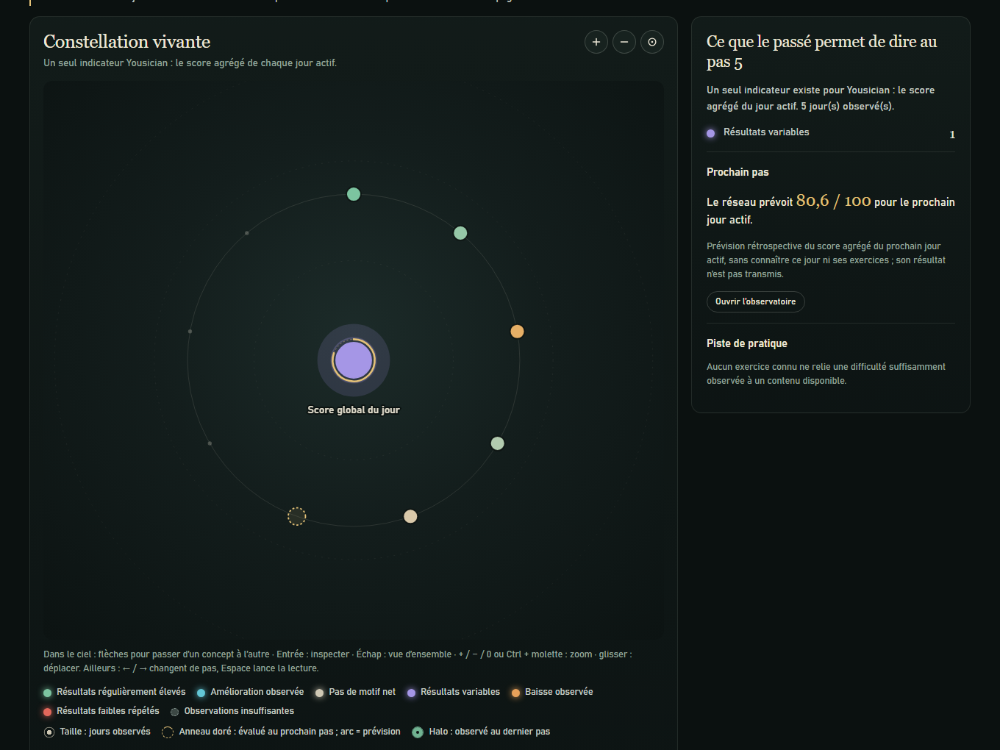
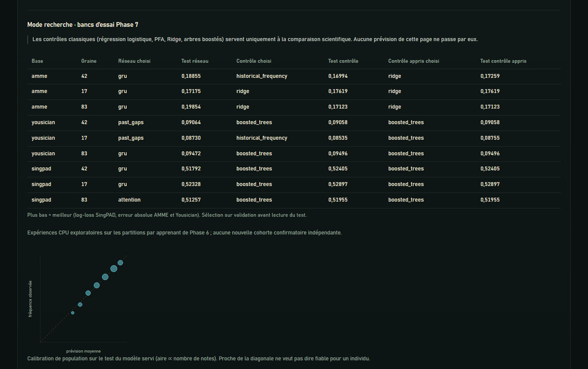

# Phase 8 · Le parcours vivant (The Living Learner)

**Page:** `http://127.0.0.1:8773/web/living.html` (any port where `axis7.server:app` runs) ·
**Branch:** `phase8/living-learner-ux` · **Scope:** O08 visual experience + one read-only presentation adapter.
Companion documents: [assimilation report](PHASE8_ASSIMILATION.md) · [visual architecture](PHASE8_VISUAL_ARCHITECTURE.md).

## What was built

Four synchronised views over **real held-out test learners**, driven by one shared state
(source, learner, cutoff, selected concept, observatory stage, reveals, research mode):

| Feature | What the user sees | Data behind every mark |
|---|---|---|
| **Machine à remonter le parcours** (dock) | Scrubber, previous/next, play/pause, ×0.5/×1/×2, keyboard ←/→/Home/End/Space. Past bars, gold ticks for forecasts made earlier, a dashed slot for the hidden next step, empty ticks for later steps. | `/state` for the chosen cutoff only; visited cutoffs are cached, later ones are never prefetched. |
| **Constellation vivante** | Fixed sky of the 270 SingPAD source concepts; stars light up as evidence arrives; state colours, evidence size, fresh-evidence halo, gold orbit + arc for the next-step forecast; co-evaluation links; zoom/pan; inspector with history sparkline, earlier forecasts, neighbours and catalogue-bound practice suggestion. | `skill_states` (policy `source-skill-state-v1`), past co-evaluation counts, GRU predictions. |
| **Empreinte musicale** | Polar record: one groove per observed step, one arc per evaluated concept (same angle as the sky), gaps = not measured; vocabulary rim; seven indicators each with definition, formula, support and sufficiency; A/B comparison of two visited moments. | Past steps only; indicators computed client-side from the same payload. |
| **Observatoire de la décision** | Historique → Encodage → Mémoire GRU → Tête → Prévision → Évaluation. Real input tensors, **recorded** GRU hidden states, logits → sigmoid, provenance, population calibration, server-mediated reveal with per-concept errors, references on identical notes, trail of every earlier forecast of the learner. Research mode adds Phase 7 benchmark tables and the reliability diagram. | `/inspect` (isolated model copy, checked equal to the served forecast), `/reveal` (HMAC receipt), `artifacts/phase7/summary.json`. |

| Constellation, concept selected | Fingerprint |
|---|---|
|  |  |
| **Observatory · recorded GRU activations** | **Observatory · real encoded input** |
|  |  |
| **Yousician: one indicator, no invented concepts** | **Research mode** |
|  |  |

Mobile (375 px, no horizontal overflow): [assets/phase8/mobile.jpg](assets/phase8/mobile.jpg).

## Scientific safeguards kept visible

* **Causal replay.** For cutoff *c* the server sends steps `0…c-1` only. Step *c* contributes its recorded
  query definition (exercise id, evaluated concept ids, as in `BenchmarkQuery`); its outcomes are absent.
  The forecast is therefore labelled *rétrospective, conditionnelle à l’exercice enregistré et aux
  concepts évalués*. Mutating step *c* and later outcomes leaves the cutoff view byte-identical (tested).
* **The network does not learn during the replay.** Fixed weights; only its input changes (said in the
  observatory). Inference goes through `musical_forecast`, the same function as Phase 7.
* **Deep Learning only on the user path.** No classical model is imported by the adapter (tested); classical
  controls appear only in research mode as published benchmarks.
* **Abstention stays visible.** Cutoff 1 shows the network's abstention (fewer than two steps); no value is drawn.
* **Missing ≠ failure.** Unmeasured concepts are gaps in the fingerprint and dots in the matrices.
* **No invented semantics.** Concepts are `Concept source k`; position depends only on the id (stated in the
  legend); links mean "evaluated in the same past recording", never a pedagogical relation; Yousician shows
  one indicator and no links.
* **Uncertainty.** No individual interval; the forecast stage shows the population calibration bin of the
  test set and says it is not individual confidence.
* **Selection.** First 8 test learners in split order with ≥ 6 steps; learner 01 is the Phase 7 demo learner
  (verified identical timestamps and forecast). Counts of eligible/excluded learners are displayed.
* **Privacy.** Learner ids never leave the server (tested); SingPAD dates are shown as day offsets.
* **Reveal.** Server-mediated, bound by an HMAC receipt to source, learner, cutoff, data digest, model digest
  and the shown predictions; the client also refuses a reveal whose predictions differ from the displayed ones.

## How to demonstrate (professor flow, ~4 minutes)

1. Open the page: *Parcours de test 01*, groupe 3 sur 28 — the exact Phase 7 demo state.
2. Press ◀ twice: groupe 1. The sky has a few faint stars; the network **abstains**.
3. Press ▶ (play): stars light up, colours settle as evidence becomes sufficient, gold ticks appear on the
   timeline as earlier forecasts get their outcomes. Pause around groupe 14.
4. Click an orange star (*Baisse observée*): inspector history, earlier forecasts (gold diamonds), next forecast.
5. Scroll to the fingerprint: grooves, gaps, indicators; "Comparer deux moments", move to groupe 20.
6. Observatory: Encodage (real tensor, the *requête* row), Mémoire GRU (recorded activations; no attention),
   Tête (logits; equality with the served forecast), Prévision (provenance, calibration bin).
7. Évaluation → *Révéler le résultat*: per-concept errors, references on the same notes, trail of every earlier
   forecast — failures included.
8. Tick *Mode recherche* for the Phase 7 benchmark tables and the reliability diagram.

Demo links open a prepared view: `?source=singpad&learner=01&cutoff=20&concept=3&stage=gru&research=1#observatory`
(a reveal is never automatic).

## Verification performed

* `pytest`: **329 passed** (315 inherited + 14 Phase 8), including the Node harness
  `tests/frontend/living_check.js` (31 checks on real API payloads) and a real-data test
  (skipped when the private archive is absent) reproducing the Phase 7 demo forecast at cutoff 3.
* Browser QA in the app's browser and headless Edge at 1440×900, mobile 375×812: no console errors, no
  horizontal overflow, keyboard navigation of the sky, playback ×2 stopping at the end, 5 cutoffs fetched
  for 5 visited (no prefetch), reveal round-trip, research mode, Yousician view.
* Latency on CPU: 20–190 ms for a first visit of a cutoff (all earlier forecasts are cached after); visited
  cutoffs are instant.

## Limits and follow-ups

* Requires the private prepared archives in `runtime/musical-demo/` (same as the Phase 7 demo); without them
  the page states that the individual histories are private.
* The total number of steps is disclosed for navigation (retrospective replay, not a blind experiment).
* Descriptive thresholds, concept ids and suggestions keep their Phase 7 status: not validated pedagogically.
* AMME is not shown: it is research-only and its effective sample is small.
* Static files are served without `Cache-Control`; asset URLs carry a version (`?v=`) to avoid stale scripts.
